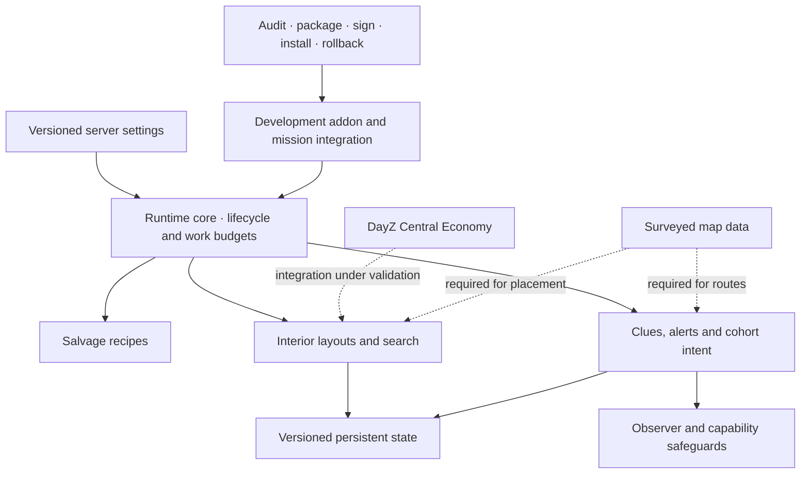

<div align="center">

# HOLLOW COUNTRY

**A survival overhaul for DayZ.**

Richer places to search. More reasons to salvage. Infected encounters grounded in the world.

[Components](#components) · [Setup](#server-setup) · [Configuration](#configuration) · [Development](#development) · [Roadmap](#roadmap)

**IN DEVELOPMENT** · DayZ PC · ChernarusPlus first · All rights reserved

</div>

---

## The field guide

Hollow Country combines loot-economy tools, persistent interior experiments,
searchable spaces, salvage crafting, and infected behavior systems. The aim is a
world that rewards observation and resourcefulness while keeping encounters fair,
server work bounded, and the server authoritative.

This repository contains addon source, mission integration, operator tools and
reproducible tests. **All gameplay feature switches default to off.** Several
systems remain deliberately gated while their native gameplay behavior is
validated. This guide distinguishes authored functionality from the experience
still being built.

## Components

| Component | What it does | Current boundary |
| :--- | :--- | :--- |
| **Runtime core** | Loads versioned settings, manages module startup/shutdown and schedules bounded server work. | Compiled and initialized in an actual DayZ server under Wine; native Windows and multiplayer qualification remain separate. |
| **Loot economy** | Audits Central Economy data and prepares conservative, reviewable changes with exact rollback. | Tooling is available. Building-coverage corrections and contextual loot require measured map data and engine eligibility checks. |
| **Interiors** | Assigns stable building identities, trial prop layouts and persistent layout history; rejects ambiguous recovery data. | Diagnostic layouts exist. Normal-build placement awaits surveyed geometry, navigation, collision and replication checks. |
| **Searching** | Provides a native continuous action with server checks for range, visibility, duration, ownership and finite allocation. | Normal-build searching is gated on CE integration and durable inventory/reward reconciliation. |
| **Salvage crafting** | Registers three recipes using existing DayZ items, with tool wear, condition loss and ownership checks. | Registration has been observed in DayZ; inventory outcomes, concurrency, recovery and balance need gameplay validation. |
| **Infected encounters** | Tracks observed clues, bounded alert relays, pack-route intent, progress and retarget scheduling. | Native perception, audibility, traversal and restart recovery need validation. Safe horde activation/abstraction and a full variant roster remain unfinished. |
| **Observer safeguards** | Rejects transitions when visibility, observer coverage, timing or provider evidence is incomplete. | A veto policy exists; it does not authorize spawning, deleting or teleporting infected. |
| **Deployment tools** | Builds packages and supports signing, verified installation, upgrade recovery and rollback. | Development signature verification and disposable install/rollback have passed; connected-client loading and production qualification remain pending. |

### Salvage, deliberately

Recover **netting from a camo net**, **wire from a cable reel**, and **tanned
leather from an empty leather belt**. The authored recipes require a knife or
pliers, consume the source, wear the tool and reduce output condition. Ownership
and container checks reject shared storage and worn attachments. Crash-safe
inventory transactions remain a validation gate.

### Infected that follow evidence

The infected foundation works with observed stimuli and finite relay chains.
Route intent and cohort ownership are tracked rather than inferred from hidden
player locations. Uncertain visibility or provider capability blocks transitions.
Persistent but escapable pressure is the goal; complete production horde behavior
has not yet been demonstrated.

## How the pieces fit



This diagram shows source responsibilities and required integrations. It does
not imply that every gameplay path is enabled or verified.

## Server setup

Use a disposable server copy and back up the mission, configuration and storage.
The current development build has not completed production gameplay qualification.

1. Read the [installation and rollback guide](docs/INSTALL_ROLLBACK.md).
2. Build and verify a development package using the
   [packaging tools](tools/package/README.md).
3. Integrate the [mission files](mission/hollow-country/README.md) and install
   the addon according to the operator guide. Addon and CE changes are separate.
4. Review the [settings template](config/hollow-country-settings.json). Keep
   unqualified features disabled and follow their documented validation gates.
5. Verify startup, client loading, persistence and rollback for the exact build,
   map and mod combination before considering live deployment.

Initial engine work targets **DayZ PC 1.30.164289** and **ChernarusPlus**. Other
maps, future builds and mod combinations require explicit qualification. The
longer-term capacity target is approximately 90 players; offline and zero-client
results do not establish that capacity. No Workshop release is available here.

## Configuration

Settings are server-owned and versioned. The template uses `SchemaVersion: 1`;
the reader rejects oversized or unsupported input. See
[addon development](docs/MOD_DEVELOPMENT.md) for loading and module behavior.

| Setting | Default | Purpose |
| :--- | :---: | :--- |
| `EnableInteriors` | `false` | Interior admission; placement has additional gates. |
| `EnableSearch` | `false` | Search admission; rewards have additional gates. |
| `EnableCrafting` | `false` | Salvage recipe admission. |
| `EnableInfected` | `false` | Experimental infected module admission. |
| `EnableHordes` | `false` | Horde work admission; capability gates still apply. |
| `EnableAlertChains` | `false` | Bounded infected alert relays. |
| `TickIntervalMs` | `1000` | Requested scheduling interval. |
| `MaxTickWorkItems` | `32` | Per-tick work budget. |
| `MaxActiveHordes` / `MaxActiveHordeMembers` | `2` / `24` | Configured horde bounds. |
| `MaxActiveInteriors` / `MaxPropsPerInterior` | `12` / `5` | Configured interior bounds. |

These are development defaults, not measured production recommendations. A switch
does not bypass a module's safety or capability checks.

## Development

Python tooling uses the standard library. With Python 3.12 installed:

```sh
python3 -B -m unittest discover -s tests/unit -v
python3 -B -m tools.validate.runtime
python3 -B -m tools.validate.hygiene
python3 -B -m tools.validate.bdd
```

Offline tests and executable scenarios support development; they cannot prove
DayZ collision, perception, audio, inventory durability, replication or
performance. Native engine and connected-client checks remain necessary.

| Looking for | Start here |
| :--- | :--- |
| Addon source | [mods/HollowCountry](mods/HollowCountry) |
| Mission integration | [mission/hollow-country](mission/hollow-country/README.md) |
| Operator documentation | [docs](docs/README.md) |
| Audit and packaging commands | [tools](tools/README.md) |
| Test suites and scenarios | [tests](tests/README.md) |
| Issues and milestones | [Project tracker](https://github.com/d-addison/hollow-country/issues) |
| Contribution workflow | [CONTRIBUTING.md](CONTRIBUTING.md) |

## Roadmap

Current work closes native gameplay, persistence, multiplayer and performance
gates for the components above. Follow the
[milestones](https://github.com/d-addison/hollow-country/milestones) for progress.

Phase 2 exploration includes:

- **Groups and navigation:** teammate icons, shared markers and an interactive
  map opened with M, with useful optional information layers.
- **Optional PvE missions:** radio-led recovery, investigation and encounters;
  AI groups, rescue, escorts and convoys depend on demonstrated capabilities.
- **Survival systems:** original extended stamina with a weight display, plus
  ecology and migration research.
- **Equipment and presentation:** weapons with verified permissions, infected
  death reactions, and supported weather/lighting improvements.
- **Distribution and portability:** Workshop preparation and explicitly tested
  map/server adapters.

These are planned investigations and features, not current gameplay promises.
Base-building expansion is outside the requested direction.

## License and assets

Copyright © 2026 David Addison. **All rights reserved.** No open-source or public
reuse license is granted. Third-party materials retain their owners' terms; see
the [provenance inventory](docs/PROVENANCE_AND_LICENSES.md).

Game files, purchased assets, Workshop packages, signing private keys, credentials
and runtime profiles do not belong in this repository.
